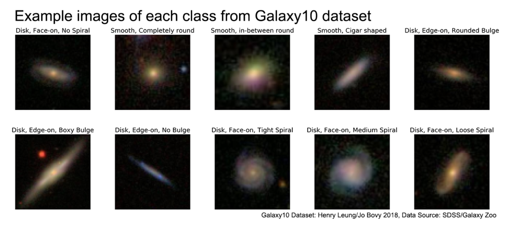

# Galaxy Shape Classification based on the Galaxy10 Dataset

Project for DAT6501 AI and Statistical Data Analysis 2026/27, by Ayoub Gutin. It trains machine learning models using the [Galaxy10 Dataset of 21785 coloured galaxies](https://astronn.readthedocs.io/en/latest/galaxy10sdss.html), to assign discrete class labels to galaxy images, describing their morphology.

---

## Information on Dataset

_Information taken from the [astroNN documentation](https://astronn.readthedocs.io/en/latest/galaxy10sdss.html)_

There are ten classes associated with the original dataset:

```Galaxy10 dataset (21785 images)
├── Class 0 (3461 images): Disk, Face-on, No Spiral
├── Class 1 (6997 images): Smooth, Completely round
├── Class 2 (6292 images): Smooth, in-between round
├── Class 3 (394 images): Smooth, Cigar shaped
├── Class 4 (1534 images): Disk, Edge-on, Rounded Bulge
├── Class 5 (17 images): Disk, Edge-on, Boxy Bulge
├── Class 6 (589 images): Disk, Edge-on, No Bulge
├── Class 7 (1121 images): Disk, Face-on, Tight Spiral
├── Class 8 (906 images): Disk, Face-on, Medium Spiral
└── Class 9 (519 images): Disk, Face-on, Loose Spiral
```

Classes are mutually exclusive, and labels were gathered from a pool of [Galaxy Zoo Volunteers](https://www.galaxyzoo.org/) to classify the images, with a 55% agreement threshold, using a [decision tree](https://data.galaxyzoo.org/gz_trees/gz_trees.html)

Dataset is composed of 69x69 (cropped and downscaled from 424x24) images of coloured galaxies, its values are the g, r, and i band.



## Acknowlegements

- Henry Leung - Compiled the Galaxy10 - [henrysky](https://github.com/henrysky)
- Jo Bovy - Supervisor of Henry Leung - [jobovy](https://github.com/jobovy)

- [Galaxy10 Labels](https://www.galaxyzoo.org/)
- [Galaxy10 Images](https://www.sdss.org/)

Funding for the SDSS and SDSS-II has been provided by the Alfred P. Sloan Foundation, the Participating Institutions, the National Science Foundation, the U.S. Department of Energy, the National Aeronautics and Space Administration, the Japanese Monbukagakusho, the Max Planck Society, and the Higher Education Funding Council for England. The SDSS Web Site is https://www.sdss.org/.

The SDSS is managed by the Astrophysical Research Consortium for the Participating Institutions. The Participating Institutions are the American Museum of Natural History, Astrophysical Institute Potsdam, University of Basel, University of Cambridge, Case Western Reserve University, University of Chicago, Drexel University, Fermilab, the Institute for Advanced Study, the Japan Participation Group, Johns Hopkins University, the Joint Institute for Nuclear Astrophysics, the Kavli Institute for Particle Astrophysics and Cosmology, the Korean Scientist Group, the Chinese Academy of Sciences (LAMOST), Los Alamos National Laboratory, the Max-Planck-Institute for Astronomy (MPIA), the Max-Planck-Institute for Astrophysics (MPA), New Mexico State University, Ohio State University, University of Pittsburgh, University of Portsmouth, Princeton University, the United States Naval Observatory, and the University of Washington.
